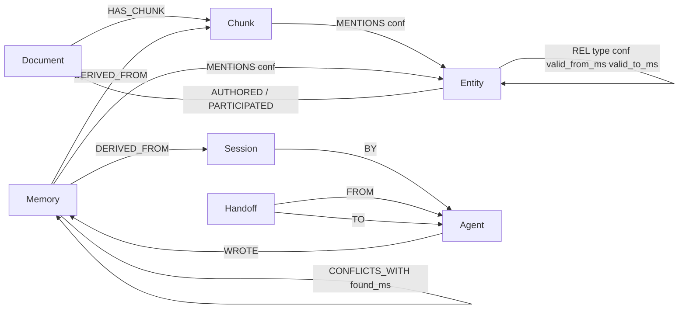

# Neo-Cortex

**One FalkorDB graph that serves as agent memory, a company brain and multi-hop reasoning, exposed to AI agents over MCP.**

Neo-Cortex stores what an agent learns and what a company knows (docs, tickets, chats, sessions) as one typed graph. Agents recall facts with cited sources, ask multi-hop questions and get the paths behind the answer, see who owns what and how a decision changed, and consolidate their memories overnight. Everything runs locally: FalkorDB (embedded falkordblite or a Docker server), GLiNER2.5 for extraction, typing and judgments, and EmbeddingGemma for vectors. There is no LLM inside the system. The calling agent (Claude Code or any MCP client) does the reasoning; the tools return compact, cited evidence.

## Tracks entered

Neo-Cortex enters all three tracks with one system.

- **01 Agents That Act on Connected Data:** `ask` and `connect` return the multi-hop graph paths (seeds, shortest `SPpaths` between them, cited chunks) that an agent acts on.
- **02 Agent Memory and Coordination:** episodic, semantic, procedural, preference and decision memories; Claude Code hooks inject a brief at session start and auto-extract memories at session end; handoffs between agents; `dream` memory consolidation (run on demand with `neo dream`).
- **03 Company Brain:** docs, tickets, ADRs and chats in one graph; `who` finds owners and experts; `timeline` traces decisions to sources and shows what superseded what.

**Explaining it:** [docs/judges-guide.md](docs/judges-guide.md) answers the questions a judge is likely to ask, with the numbers and where they come from. An interactive explainer of the whole project lives at [docs/explainer/index.html](docs/explainer/index.html).

**Ideas it builds on** ([docs/lineage.md](docs/lineage.md)): GLiNER2.5 as a no-LLM "System 1" model, HippoRAG-style personalized PageRank, pg-jev-style cached decisions stored as graph nodes (now fully built: cached decisions + assertion gating), an RRSI-style acceptance rule for self-tuning (the tuner rejected its own weights), Dream-RSI-style offline memory consolidation (`neo dream`), bm25s with reciprocal rank fusion, anydoc for Office/PDF conversion, and an OKF knowledge bundle for the project's own research. The page says what was taken, where it lives in the code, what was measured and what was not built.

## Why the graph does real work

The graph is the only store. Memories, documents, entities and relations all live in FalkorDB, and the retrieval channels read from it:

- Personalized PageRank over typed entity relations and mentions (graph channel) finds evidence two or three hops from the query. On document retrieval it ties text search (Table B).
- `algo.SPpaths` and variable-length paths produce the bridging paths for `ask`, `connect` and `who`.
- Ownership and supersession are edges (`OWNS`, `SUPERSEDES`, `valid_to_ms`), so "current owner" and "what changed" are graph queries, not text search. Measured, impact (blast radius) is the one category where the graph clearly beats text search (Table A). Current owner ties, and value-change answers did not beat the baseline.

Setup: a synthetic company corpus of 102 documents (`data/synthetic`, AI-generated, fictional), 80 retrieval questions and 30 structured-answer questions. Gold labels were written from a world spec (`data/synthetic/WORLD.md`) that the product never reads. Every comparison is a paired bootstrap (1000 resamples, seed 0) with 95% CIs over questions.

**Table A: graph-native answers vs text search** (30 questions, 4000-char budget on both sides; baseline = top-8 vector chunks). "Keys" = share of expected keys present; "all keys" = every key present.

| Category (n) | Tool, all keys | Baseline, all keys | Tool minus baseline, 95% CI |
|---|---|---|---|
| Impact / blast radius (10) | 0.80 | 0.20 | +0.60 [+0.30, +0.90], significant |
| Current owner (10) | 1.00 | 1.00 | +0.00 [+0.00, +0.00], tie (correct current owner 1.00 vs 1.00) |
| Value changes (10) | 0.80 | 1.00 | -0.20 [-0.50, +0.00], inside noise, tool lower |
| Overall (30) | 0.87 | 0.73 | +0.13 [-0.03, +0.33], inside noise |

Keys (partial) scores, tool vs baseline: impact 0.80 vs 0.34, current owner 1.00 vs 1.00, value changes 0.92 vs 1.00, overall 0.91 vs 0.78.

**Table B: document retrieval** (80 questions, top 10 unique documents). Recall@10 = share of gold documents found, averaged; FullCover@10 = share of questions where every gold document is found.

| Config | Recall@10 | FullCover@10 |
|---|---|---|
| vector | 0.73 | 0.53 |
| bm25 | 0.71 | 0.54 |
| vector+bm25 | 0.75 | 0.59 |
| auto (graph-routed, product default) | 0.74 | 0.56 |
| full (all four channels, intent weights) | 0.76 | 0.60 |

Graph routing ties text retrieval on finding documents; the CIs include 0. Full vs vector+bm25: Recall@10 +0.006 [-0.029, +0.040], FullCover@10 +0.013 [-0.062, +0.087]. Since 2026-10-17 the graph channel only runs when a query entity links strongly (seed-strength gate), which fixed real-docs rankings (below) at a cost of 1-2 synthetic questions on `auto`.

**`ask` at equal output size** (`eval/run_eval.py`, 2026-10-18; the baseline text is cut to the same number of characters as `ask`'s evidence pack): answer keys present in multi-hop questions +0.23 over vector top-8 [+0.04, +0.42], significant; multi-hop plus ownership +0.07 [-0.09, +0.23], inside noise; ownership alone -0.18 [-0.41, +0.06]. With the unequal default budget the pack looked worse (-0.12), because it is shorter.

**Extraction** (`eval/graph_quality.py`, graded relation types on the ingested graph): relation precision 0.88, recall 0.83.

### System 1 decisions, measured

| Decision | How | Measured result | Kept |
|---|---|---|---|
| Edge assertion gate: every extracted relation is classified on its source sentence as fact / possibility / denial / plan; `modality` and `p_fact` are stored on the edge; current-state tools and the graph walk read facts only | Default gate = base GLiNER2.5 + a negation-cue rule; agent-written edges are facts | Trap probe of 25 hand-labelled sentences: model only 17/25, model + rule 20/25; synthetic fact-only relations P 0.880 -> 0.903, R 0.825 -> 0.812 (neutral F1 0.852 -> 0.855) | Yes — default |
| GLiNER2.5-Decide (`fastino/GLiNER2.5-Decide`) as the gate | best wording on the same trap probe | 20/25, but a second ~1.9 GB model about 6x slower | No |
| JointIE + one combined schema behind `NEO_EXTRACT` | typed entity-relation decoding vs the default split extractor | P 0.719 and 0.774 vs 0.880 for split; slower on real documents (222 s and 140 s vs 92 s synthetic ingest) | No — default stays split |
| fp16 GLiNER on the GTX 1660 Ti | `NEO_GLINER_FP16=1` | Peak GPU memory halved (1098 -> 589 MB), ~2.4x slower per call | Opt-in, not default |
| HTML ingestion | built-in standard-library converter (anydoc has no HTML reader) | HTML now converts to Markdown | Yes |

**Ideas from open memory systems, measured** (`eval/flags.md`): seven retrieval and resolution changes taken from agentmemory (fusion normalisation), graphify (BM25 term coverage, per-term seeds, Jaro-Winkler merge) and Hindsight (two-phase temporal) are in the code behind flags. None beat the default across both corpora, so all stay off: for example term-coverage BM25 raised real-docs Hit@5 from 0.50 to 0.60 but lowered MRR, and the Jaro-Winkler merge wrongly merged `FalkorDB` into `falkordblite`.

The published gain this idea came from (edge F1 0.330 -> 0.396, one author's 10-doc corpus with Decide) did not reproduce here.

**Real docs** (`eval/real_check.py`, this repository's own 72 docs, 30 questions an agent working on it asks, gold in `eval/real_gold.jsonl`; report in [eval/real_check.md](eval/real_check.md)): the gold document is in the top 5 for 0.50 of questions (MRR 0.41); the answer string is in the top-5 documents' chunks for 0.70 (facts are often repeated across docs) and in what `recall` prints for 0.47 (0.30 before it showed query-matching sentences instead of each chunk's head). Recall p50 about 370 ms, `ask` about 650 ms. GLiNER finds few relations in real prose (5 edges in 72 docs, now that command text in code fences is skipped), so agents write relations directly with `remember(entities=, relations=)` and `relate`.

Reproduce: measurement details in [eval/README.md](eval/README.md); numbers in [eval/results.md](eval/results.md) and [eval/answers.md](eval/answers.md).

```bash
NEO_DEVICE=cuda uv run --no-sync python eval/run_eval.py     # retrieval (ingests the corpus first)
NEO_DEVICE=cuda uv run --no-sync python eval/answers.py      # graph-native answers
NEO_DEVICE=cuda uv run --no-sync python eval/graph_quality.py --ingest   # extraction
```

## Quickstart

**Prerequisites:** Linux, Python 3.12, [uv](https://docs.astral.sh/uv/), and optionally an NVIDIA GPU (`NEO_DEVICE=auto` uses CUDA when torch sees one, else CPU).

```bash
# 1. Install the Python environment (dependencies are pinned in uv.lock).
#    Keep about 3 GB free. On tmpfs or when the uv cache is on another
#    filesystem, run `UV_LINK_MODE=symlink uv sync` instead.
uv sync
# Verify the environment before downloading models.
uv run --no-sync python -c "import torch, gliner2"
# If a sync is interrupted and the venv is broken: rm -rf .venv, then rerun uv sync.

# 2. Download the models into the repo root (they are not in git).
#    Alternatively, point these variables at already-downloaded local directories.
uv run --no-sync hf download fastino/gliner2.5-base-v1 --local-dir gliner2.5-base-v1
uv run --no-sync hf download google/embeddinggemma-2 --local-dir embeddinggemma-2
# export NEO_GLINER=/path/to/gliner2.5-base-v1
# export NEO_EMBED=/path/to/embeddinggemma-2

# 3. In one terminal, start the daemon: the only process that opens the graph.
#    --port is the daemon HTTP port (MCP /mcp, hooks /api, health /health).
uv run --no-sync neo serve --port 8765 --warm
# Leave this terminal running; stop the daemon with Ctrl-C.

# 4. In another terminal, put `neo` on PATH so hooks start in milliseconds.
#    This is a global editable install: it follows this checkout and can shadow
#    another `neo` command on PATH.
uv tool install --editable .
neo --version
# Register MCP and hooks. Run the printed `claude mcp add ...` command; its URL
# uses the daemon port you chose above. Add --yes to merge hooks into settings.
neo install-claude --scope user

# 5. Load the synthetic company corpus and ask a question.
#    --wait follows each asynchronous directory job before the next one starts.
for d in doc adr ticket chat meeting session; do uv run --no-sync neo ingest --wait data/synthetic/$d; done
uv run --no-sync neo status
uv run --no-sync neo ask "Who should review a change to the session cache today?"
```

`neo status` reports daemon health, background jobs and graph counts. On a fresh
graph, `0 rows: label | n` is an empty count, not an error. The daemon uses
`--port` for its HTTP endpoints; embedded falkordblite uses `NEO_PORT` for its
own Redis-compatible port (default `6390`). If hooks should use `NEO_*` settings,
export them in the environment that launches Claude Code: hooks inherit Claude
Code's environment.

Example queries on the synthetic corpus (`data/synthetic`, fictional company);
the comments name the data kinds needed for each answer:

```bash
neo ask "Whose configuration edit lay behind the 41-minute payment outage that hit Orchard & Vane?"   # ticket, chat, adr
neo recall "What is the current session TTL?" -k 5                                                      # adr, doc, chat
neo who "session cache"                                                                                # doc, adr, meeting
neo timeline "session TTL"                                                                              # adr, doc, chat, session
neo brief                                                                                               # session/memory data
```

`ask` returns an evidence pack rather than prose: read its seeds, bridging
paths, cited chunks and facts, then have the calling agent write the answer.
Ingest only the six kind folders: `data/synthetic/WORLD.md` is the answer key the corpus was written from, so it must never be in the graph. See [eval/README.md](eval/README.md).

Without the daemon running, `neo` commands open the embedded database themselves, but only when no daemon answers. The graph is single-owner by design: the embedded database takes an exclusive file lock, so exactly one process (normally the daemon) has it open and a second writer gets an error naming that lock. Data is partitioned by **tenant**: each tenant is its own graph (`neo_<tenant>`, chosen with `--tenant`, default `default`), so a company brain and a personal agent memory can share one server without seeing each other's data.

### FalkorDB modes

- **Embedded (default):** falkordblite starts a server bound to `127.0.0.1:6390` (`NEO_PORT`), data in `~/.neo-cortex/neo.rdb` (`NEO_HOME`). Nothing else to run.
- **Docker or self-hosted:** start the server, then point Neo-Cortex at it.

  ```bash
  docker compose up -d falkordb                  # docker-compose.yml, loopback ports 6379 and 3000
  export NEO_FALKORDB_URL=redis://localhost:6379
  ```

**FalkorDB Browser** shows the graph: open `http://127.0.0.1:3000` for the Docker server, or connect it to `127.0.0.1:6390` while the embedded daemon runs. Settings are in [.env.example](.env.example).

Documentation: [docs/architecture.md](docs/architecture.md) (diagram, write and read pipelines) and [docs/cypher.md](docs/cypher.md) (every Cypher query and graph algorithm the product depends on, with the function that issues it).

## Graph data model



Every node has `id` (string). Times are `*_ms` epoch-millisecond integers. Each tenant is its own graph (`neo_<tenant>`), so there is no tenant property.

In plain words: a **Document** is one source file (its `kind` says what it is); a **Chunk** is a slice of it that carries the embedding and the citation; an **Entity** is every named thing the text mentions (person, service, file, ticket...), deduplicated across name variants; a **Memory** is one fact an agent or a session chose to keep, with a `kind` — episodic (what happened), semantic (what is true), procedural (how to do it), preference (how the user wants it), decision (what was decided); a **Session** is an ingested agent conversation, an **Agent** is who acted, and a **Handoff** is work one agent leaves for another.

Data enters the graph two ways. Ingested documents and session transcripts go through **GLiNER2.5**, which extracts entities and typed relations, classifies memory kinds, routes queries by intent and judges borderline entity merges (it can only veto a merge, never create one). When the agent already knows the facts, it writes them directly: `remember(text, kind=..., entities=..., relations=...)` skips GLiNER entirely, and `relate(head, TYPE, tail)` writes or corrects one typed edge (`supersede` closes the edge it replaces, `end` closes it with no replacement). Names the agent passes explicitly match by exact key or alias only, never fuzzily. Extracted names go through **entity resolution**: exact normalised key, then alias, then a variant key that ignores spacing, case, punctuation and version suffixes (`GLiNER 2.5 base` = `gliner2.5-base-v1`), then vector neighbours that pass a lexical guard; borderline pairs go to the cached GLiNER judge.

| Node | Key properties |
| --- | --- |
| `Document` | `id, kind (doc, adr, ticket, chat, meeting, session, file), title, uri, path, author, date_ms, status, labels, hash` |
| `Chunk` | `id (<doc id>#<pos>), doc_id, pos, text, kind, date_ms, emb` (`date_ms` is the document date) |
| `Entity` | `id, key (normalised name), name, type, aliases, emb, first_seen_ms, last_seen_ms, mentions` |
| `Memory` | `id, text, kind (episodic, semantic, procedural, preference, decision), confidence, created_ms, valid_from_ms, valid_to_ms, status (active, superseded, merged), uses, last_used_ms, decayed_ms, source_id, agent, project, emb` |
| `Session` | `id, agent, project, started_ms, path, hash` |
| `Agent` | `id, name` |
| `Handoff` | `id, summary, tasks, status (open, done), created_ms` |
| `DreamRun` | `id, at_ms, merged, promoted, decayed, conflicts` (one per real `dream` run) |
| `Judgment` | `id (content hash), question, result, created_ms` (cache for GLiNER yes/no and choice decisions) |

Entity types: person, team, service, component, file, config_setting, ticket, customer, product, tool, incident, decision, other.

REL types (one relationship type with a `type` property, so Cypher never builds types from strings): OWNS, MEMBER_OF, DEPENDS_ON, CAUSED_BY, FIXED_BY, APPROVED, DECIDED, PART_OF, WORKS_ON, REPORTED, REPLACED_BY, RENAMED_TO, RELATED_TO.

Each REL edge carries `conf` (confidence 0-1), `source_id` (the chunk, memory or `relate` call that justified it) and `valid_from_ms`/`valid_to_ms` — an edge with an end date is closed history, skipped by queries about "now". Between memories, `SUPERSEDES` retires a replaced fact, `CONFLICTS_WITH` flags two facts that disagree, and `MERGED_INTO` marks a duplicate folded into another.

## How we use FalkorDB

FalkorDB is the only store, and the graph does work the agent could not do from files:

| FalkorDB feature | What Neo-Cortex does with it | Where |
|---|---|---|
| One graph per tenant (`neo_<tenant>`) | team and project isolation; an agent cannot read another tenant by accident | `store.py` |
| Vector indexes (`db.idx.vector.queryNodes`, cosine, 768-d) on `Chunk.emb`, `Memory.emb`, `Entity.emb` | the vector channel of `recall`, entity linking fallback, duplicate-memory check, dream merge candidates | `retrieve/channels.py`, `write.py`, `dream.py` |
| Full-text index on `Entity.name` | fuzzy entity-name lookup for linking a question's words to entities | `channels.link_entities` |
| `algo.SPpaths` | bridging paths between two entities: `connect` (up to 5 paths, 4 hops) and the paths in `ask` | `tools.py _paths` |
| Variable-length paths `[:REL*1..2]` with a type filter | `who` (owners and experts) and `impact` (blast radius over `DEPENDS_ON`) | `tools.py who, impact` |
| Property graph with time on edges (`valid_from_ms`, `valid_to_ms`) | `timeline`, supersession of owners, current-only walks | `write.py _supersede`, `tools.py timeline` |
| `GRAPH.RO_QUERY` | the agent's read-only `cypher` tool; writes are rejected by the server | `tools.py cypher` |
| Audit nodes (`Judgment`, `DreamRun`, `TuneRun`) | cached model decisions, consolidation runs and tuning trials are data in the same graph | `resolve.py`, `dream.py`, `eval/tune.py` |
| falkordblite (embedded) or Docker | same Cypher either way; one file lock so only one process owns the data | `store.py` |

Not used on purpose: `algo.pageRank` has no personalization vector, so Personalized PageRank (the HippoRAG idea) runs in numpy over a subgraph fetched with plain Cypher.

## Key Cypher queries and graph algorithms

The full list, with the function that issues each query, is [docs/cypher.md](docs/cypher.md). The queries the product depends on:

```cypher
// Vector search (recall, entity linking, duplicate check): smaller score = nearer
CALL db.idx.vector.queryNodes('Chunk','emb',20,vecf32($v)) YIELD node, score RETURN node.id, score

// Shortest bridging paths between two entities (connect, ask)
MATCH (a:Entity {id:$a}), (b:Entity {id:$b})
CALL algo.SPpaths({sourceNode:a, targetNode:b, relTypes:['REL'], maxLen:4, relDirection:'both', pathCount:5}) YIELD path
RETURN [x IN nodes(path) | [x.id, x.name]], [r IN relationships(path) | [r.type, startNode(r).id, r.source_id, r.valid_from_ms, r.conf]]

// Who owns or knows this? (who): people reaching the topic through ownership-type edges, up to 2 hops
MATCH p=(x:Entity {type:'person'})-[:REL*1..2]->(t:Entity)
WHERE t.id IN $t AND all(r IN relationships(p) WHERE r.type IN $ty)
RETURN x.id, x.name, [n IN nodes(p) | [n.id, n.name]], [r IN relationships(p) | [r.type, startNode(r).id, r.source_id, r.valid_from_ms, r.conf]]

// Supersession: a new owner closes the old OWNS edge instead of deleting it (history stays queryable)
MATCH (a:Entity)-[r:REL {type:$t}]->(b:Entity) WHERE b.id IN $e RETURN id(r), a.id, b.id, r.valid_from_ms, r.valid_to_ms
UNWIND $r AS x MATCH ()-[r:REL]->() WHERE id(r) = x.i SET r.valid_to_ms = x.v

// Subgraph for Personalized PageRank (graph channel): current edges only, then PPR runs in numpy
MATCH (a:Entity)-[r:REL]-(b:Entity) WHERE a.id IN $ids AND (r.valid_to_ms IS NULL OR r.valid_to_ms > $now)
RETURN a.id, b.id, b.name, b.mentions, r.type, coalesce(r.conf, 0.5), startNode(r).id

// Timeline of one entity: dated edges, with who superseded whom
MATCH (a:Entity)-[r:REL]-(b:Entity {id:$i}) RETURN a.id, a.name, r.type, startNode(r).id = a.id, r.valid_from_ms, r.source_id, r.conf

// Agent escape hatch (read-only, GRAPH.RO_QUERY): what neo status runs
MATCH (n) RETURN labels(n)[0] AS label, count(n) AS n ORDER BY n DESC
```

Graph algorithms: `algo.SPpaths` (shortest paths), variable-length path traversal (`who`, `impact`), Personalized PageRank (HippoRAG-style, numpy, at most 3 hops and 500 nodes, gated by seed strength), and weighted Reciprocal Rank Fusion over four channels (k=60).

## Research behind it, and how it is implemented

| Idea | Paper / code | How Neo-Cortex implements it in FalkorDB | Measured |
|---|---|---|---|
| **pg-jev**: small "System 1" models judge text and return calibrated probabilities, not generated text | [realZachi/pg-jev](https://github.com/realZachi/pg-jev) (Postgres extension, [pgjev.com](https://pgjev.com)); GLiNER2 paper [arXiv 2507.18546](https://arxiv.org/abs/2507.18546) | Every borderline entity judgment is cached as a `(:Judgment)` node keyed by a hash of question, text and labels (`resolve.py judge`). Every extracted relation is classified on its source sentence as fact, possibility, denial or plan; `modality` and `p_fact` live on the `REL` edge and the current-state tools read facts only (`extract.py _gate`) | trap probe 20/25 vs 17/25 for the model alone; [eval/graph_quality.md](eval/graph_quality.md) |
| **RRSI**: self-improvement only when a regularised, held-out check accepts the change | [google-research/rrsi](https://github.com/google-research/rrsi); paper [arXiv 2609.24972](https://arxiv.org/abs/2609.24972) ([project page](https://regularized-rsi.com/)) | `eval/tune.py` searches channel weights on odd questions and accepts them only if the paired-bootstrap 95% lower bound on even questions is above 0 and latency is within 20%. Each trial is a `(:TuneRun)` node. It rejected its own weights | [eval/tune_clean.json](eval/tune_clean.json) |
| **Dream-RSI**: offline "dreaming" that consolidates experience | [zhengkid/Dream-RSI](https://github.com/zhengkid/Dream-RSI); [paper PDF](https://github.com/zhengkid/Dream-RSI/blob/main/papers/Dream-RSI.pdf) ([dream-rsi.com](https://www.dream-rsi.com); the arXiv posting is announced as in progress) | `neo dream` (`dream.py`): merges near-duplicate memories (cosine >= 0.92, never across a differing number or a negation), promotes episodic clusters seen in 3+ sessions to semantic, decays idle confidence, flags `CONFLICTS_WITH` pairs. Deterministic and idempotent; each run is a `(:DreamRun)` node; merged memories keep a `MERGED_INTO` edge | `tests/test_dream.py` (no eval number) |
| **HippoRAG**: Personalized PageRank over a knowledge graph for retrieval | [arXiv 2405.14831](https://arxiv.org/abs/2405.14831), [HippoRAG 2, arXiv 2502.14802](https://arxiv.org/abs/2502.14802) | The graph channel seeds PPR with the question's linked entities over entity and chunk-mention edges fetched by Cypher, in numpy | [eval/results.md](eval/results.md) |
| **BM25 + RRF** | [BM25S, arXiv 2407.03618](https://arxiv.org/abs/2407.03618); Cormack, Clarke and Buettcher, "Reciprocal Rank Fusion outperforms Condorcet and individual rank learning methods", SIGIR 2009 | `bm25s` index next to FalkorDB (its full-text index is not BM25); four channels fused with weighted RRF | [eval/results.md](eval/results.md) |

More detail on what was taken, what was left out and what failed: [docs/lineage.md](docs/lineage.md).

## MCP tools and CLI

The daemon exposes 15 MCP tools (`neo serve`, streamable HTTP at `/mcp`). Each tool returns token-budgeted text with ids, sources, dates, confidence and the channels or paths that matched.

| Tool | What it does |
| --- | --- |
| `brief(project?, agent?, max_chars?)` | Session-start context: preferences, active decisions, lessons, facts, recent episodes, open handoffs |
| `recall(query, k?, since?, until?, kinds?)` | Hybrid search (vector, BM25, graph, temporal) with "why it matched" |
| `remember(text, kind?, about?, supersedes?, entities?, relations?)` | Store a memory; dedupes, flags conflicts, links the memory it supersedes. With `kind` plus entities or relations you already know, nothing is extracted |
| `ask(question)` | Multi-hop evidence pack: seeds, bridging paths, cited chunks and facts |
| `explore(entity, hops?, since?)` | Compact neighbourhood of an entity (up to 3 hops) |
| `connect(a, b, max_hops?)` | Shortest relation paths between two entities |
| `who(topic)` | Owners and experts for a topic, from ownership paths and authorship |
| `timeline(topic, since?, until?)` | Dated events about a topic, with the values stated in each source and supersession |
| `impact(entity, max_hops?)` | Blast radius: what depends on it (current `DEPENDS_ON`, both ways), the owners to tell, linked customers and incidents |
| `relate(head, type, tail, source?, supersede?, end?)` | Write or correct a typed edge (`OWNS`, `DEPENDS_ON`, ...); `supersede` closes the edge it replaces, `end` closes it with no replacement |
| `read(id, max_chars?)` | Full text of a chunk, memory or document by id, with metadata and neighbour ids |
| `ingest(path_or_text, kind?)` | Ingest a file, a directory or text (a directory can be queued with `background`) |
| `handoff(to?, summary?, tasks?, done?)` | Leave work for another agent (shown in its `brief`), or mark a handoff done |
| `cypher(query, limit?)` | Read-only Cypher, the escape hatch (the schema is in the tool description) |
| `dream(dry_run?)` | Consolidate memories: merge duplicates, promote recurring episodes, decay, flag conflicts |

CLI (`neo`, every command except `serve`, `status`, `hook` and `install-claude` takes `--tenant`):

| Command | Purpose |
| --- | --- |
| `neo serve [--port 8765] [--warm]` | Start the daemon; `--warm` loads the models at start |
| `neo status` | Daemon health, the ingest queue and node counts |
| `neo brief [--project] [--agent]` | Print the brief |
| `neo recall "<q>" [-k K]` | Hybrid search |
| `neo ask "<question>"` | Multi-hop evidence pack |
| `neo who "<topic>"` / `neo timeline "<topic>"` | Owners and experts / dated events |
| `neo explore "<entity>"` / `neo connect "<a>" "<b>"` | Neighbourhood / relation paths |
| `neo impact "<entity>" [--max-hops]` | Blast radius: dependents, owners to tell, customers and incidents |
| `neo relate "<head>" <TYPE> "<tail>" [--source] [--supersede] [--end]` | Write or correct a typed edge |
| `neo read <id>` | Full text of a chunk, memory or document by id |
| `neo remember "<text>" [--kind] [--about] [--supersedes] [--entity Name:type]... [--rel 'head\|TYPE\|tail']... [--agent] [--project]` | Store a memory |
| `neo ingest <path> [--wait]` | Ingest a file, or queue a directory as a daemon job (prints the job id; `--wait` follows it) |
| `neo jobs [id]` | Status and result of the daemon's background jobs |
| `neo ingest-session <transcript.jsonl> [--agent] [--project]` | Extract memories from a Claude Code transcript |
| `neo handoff "<summary>" --to <agent> [--task T]...` | Leave a handoff |
| `neo cypher "<query>"` | Read-only Cypher |
| `neo dream [--dry-run]` | Run memory consolidation |
| `neo hook session-start\|session-end\|pre-compact` | Claude Code hook entry point (reads hook JSON on stdin) |
| `neo install-claude [--scope user\|project] [--yes]` | Print the hooks JSON and the `claude mcp add` command; `--yes` merges the hooks |

For stdio clients: `uv run --no-sync python -m neo_cortex.mcp_server --transport stdio`.

## Retrieval

`recall` runs four channels and fuses them:

1. **Vector:** EmbeddingGemma query embedding over Chunk and Memory vector indexes (cosine).
2. **BM25:** `bm25s` over the same texts, in process (FalkorDB full-text is only used for fuzzy entity names).
3. **Graph:** Personalized PageRank (HippoRAG-style) over a local subgraph: at most 3 hops and 500 nodes. Seeds are the query's linked entities plus the entities of the top dense and BM25 hits. A seed-strength gate keeps the channel out of the fusion unless a query entity links strongly to the graph, so weak or wrong entity matches cannot pull rankings off the text channels.
4. **Temporal:** explicit windows ("since", "last 30 days", "15 July 2026") filter; "current" and "latest" only boost recency. A window that matches nothing is dropped.

Fusion is weighted reciprocal rank fusion, `score = sum_c w_c / (60 + rank_c)`. Base weights are 1.0 (temporal 0.5), scaled by the GLiNER intent of the query: connection and owner questions boost the graph channel, temporal questions boost temporal, fact questions boost BM25 and vector and damp the graph. Soft intent weights mean one misroute nudges the ranking instead of breaking it. Superseded memories stay hidden unless the question is about change; merged memories never appear.

## Memory lifecycle

- **Remember:** a memory at cosine 0.92 or more to an active one reinforces it (`uses + 1`). Between 0.75 and 0.92 with a shared entity it is returned as a conflict for the agent to resolve. `remember(..., supersedes=<id>)` links `SUPERSEDES` and retires the old memory.
- **Sessions:** the `SessionEnd` and `PreCompact` hooks send the transcript to the daemon, which returns at once and extracts up to 15 memories in the background. Deterministic patterns pick self-contained statements (preferences, decisions, lessons); GLiNER only scores them. The `SessionStart` hook injects the brief, so memory works even if the agent never calls `remember`.
- **Dream:** merges near-duplicates, promotes an episodic cluster seen in 3 or more sessions to one semantic memory with provenance, decays unused memories (never deleted), and flags conflicting semantic or decision memories. Re-running changes nothing.

Hooks are installed by `neo install-claude`. Details: [integrations/claude-code/README.md](integrations/claude-code/README.md).

## Evaluation

- Corpus: synthetic Pellucid Pay company, 102 AI-generated, fictional documents (`data/synthetic`; spec in `data/synthetic/WORLD.md`).
- Gold set: 80 questions (single-hop, multi-hop, temporal, ownership, procedural) in `eval/gold.jsonl`, checked by `eval/check_dataset.py`.
- Ablation: vector, BM25, vector plus BM25, plus graph, plus temporal, full (intent weights), and the product default; with paired-bootstrap confidence intervals.
- How to run and the full results: [eval/README.md](eval/README.md), [eval/results.md](eval/results.md), [eval/results.json](eval/results.json).
- Real-docs check: the repository's own 72 docs and 30 questions an agent working on it asks (`eval/real_check.md`), reported above with its misses — a second evaluation on prose GLiNER was not tuned for.

<!-- DEMO_VIDEO -->

## AI use disclosure

Neo-Cortex was built with Claude Code, using Anthropic Claude models as the
orchestrator and coding sub-agents. Some tasks were done with GitHub Copilot
CLI, CodeBuddy (GLM-5.3-Flash) and OpenCode. The synthetic company corpus and
gold questions were AI-generated from a written specification and are
fictional. Humans directed, reviewed and verified the work, and are
responsible for the architecture, correctness claims and submitted material.

Team: <!-- TEAM -->

## Licenses and third-party components

- FalkorDB server: SSPLv1, per the FalkorDB repository README. Whether SSPLv1 counts as open source for the hackathon rules is an open question for the organisers ([knowledge/hackathon/rules.md](knowledge/hackathon/rules.md#falkordb-license-note)).
- falkordblite (embedded server): BSD License, from the installed package metadata.
- GLiNER2.5 Base (`fastino/gliner2.5-base-v1`): Apache-2.0, per the model card and its Hub tag ([knowledge/models/gliner2-5-base.md](knowledge/models/gliner2-5-base.md)).
- EmbeddingGemma 2 (`google/embeddinggemma-2`): the Hub tag and the card header say Apache-2.0, but the card's license link points to a Gemma license URL. Read that link before redistributing the weights ([knowledge/models/embeddinggemma.md](knowledge/models/embeddinggemma.md)).
- The synthetic corpus and gold set are generated for this project and are not third-party data. The public open-source data is fetched on demand by `scripts/fetch_public.py` and is not committed.

## Limitations

- **Small evaluation:** one synthetic corpus and 80 questions written by the same team that built the tools. The numbers show the design works on this corpus; they do not establish general accuracy.
- **Relation recall:** GLiNER finds many entities but misses many relations. Deterministic patterns recover some ownership, dependency and supersession phrases; other relations are absent from the graph, and the answer then depends on the text channels.
- **Single node:** one daemon owns one graph. There is no replication, no multi-writer scaling and no authentication beyond the loopback-only binding. Keep the daemon on the loopback interface.
- **No LLM by design:** `ask` returns evidence and paths, and the calling agent writes the answer. Answer quality depends on that agent.
- **Full-text and BM25 rebuilds:** the BM25 index is rebuilt in full whenever the corpus changes, which is fine at the demo size and is noted in the code.
- **Docker volume:** the compose file's persistence path for the combined FalkorDB image is not verified by a run; see the comment in [docker-compose.yml](docker-compose.yml).
