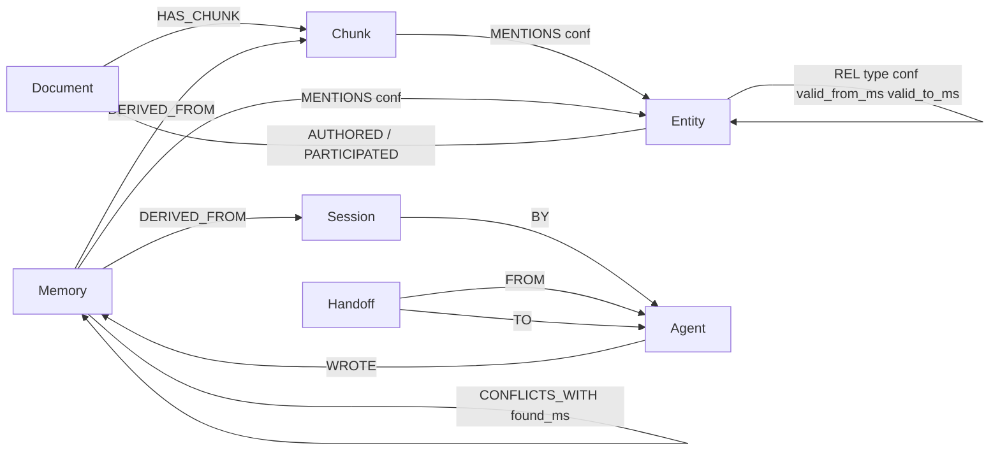

# Neo-Cortex

**One FalkorDB graph that serves as agent memory, a company brain and multi-hop reasoning, exposed to AI agents over MCP.**

Neo-Cortex stores what an agent learns and what a company knows (docs, tickets, chats, sessions) as one typed graph. Agents recall facts with cited sources, ask multi-hop questions and get the paths behind the answer, see who owns what and how a decision changed, and consolidate their memories overnight. Everything runs locally: FalkorDB (embedded falkordblite or a Docker server), GLiNER2.5 for extraction, typing and judgments, and EmbeddingGemma for vectors. There is no LLM inside the system. The calling agent (Claude Code or any MCP client) does the reasoning; the tools return compact, cited evidence.

## Tracks entered

Neo-Cortex enters all three tracks with one system.

- **01 Agents That Act on Connected Data:** `ask` and `connect` return the multi-hop graph paths (seeds, shortest `SPpaths` between them, cited chunks) that an agent acts on.
- **02 Agent Memory and Coordination:** episodic, semantic, procedural and preference memories; Claude Code hooks inject a brief at session start and auto-extract memories at session end; handoffs between agents; `dream` memory consolidation (run on demand with `neo dream`).
- **03 Company Brain:** docs, tickets, ADRs and chats in one graph; `who` finds owners and experts; `timeline` traces decisions to sources and shows what superseded what.

## Why the graph does real work

The graph is the only store. Memories, documents, entities and relations all live in FalkorDB, and the retrieval channels read from it:

- Personalized PageRank over typed entity relations and mentions (graph channel) finds evidence two or three hops from the query. On document retrieval it ties text search (Table B).
- `algo.SPpaths` and variable-length paths produce the bridging paths for `ask`, `connect` and `who`.
- Ownership and supersession are edges (`OWNS`, `SUPERSEDES`, `valid_to_ms`), so "current owner" and "what changed" are graph queries, not text search. Measured, impact (blast radius) is the one category where the graph clearly beats text search (Table A). Current owner ties, and value-change answers did not beat the baseline.

Setup: a synthetic company corpus of 102 documents (`data/synthetic`, AI-generated, fictional), 80 retrieval questions and 30 structured-answer questions. Gold labels were written from a world spec (`data/synthetic/WORLD.md`) that the product never reads. Every comparison is a paired bootstrap (1000 resamples, seed 0) with 95% CIs over questions.

**Table A: graph-native answers vs text search** (30 questions, 4000-char budget on both sides; baseline = top-8 vector chunks). "Keys" = share of expected keys present; "all keys" = every key present.

| Category (n) | Tool, all keys | Baseline, all keys | Tool minus baseline, 95% CI |
|---|---|---|---|
| Impact / blast radius (10) | 0.80 | 0.20 | +0.60 [+0.30, +0.90], significant |
| Current owner (10) | 1.00 | 1.00 | +0.00 [+0.00, +0.00], tie (correct current owner 1.00 vs 1.00) |
| Value changes (10) | 0.80 | 1.00 | -0.20 [-0.50, +0.00], inside noise, tool lower |
| Overall (30) | 0.87 | 0.73 | +0.13 [-0.03, +0.33], inside noise |

Keys (partial) scores, tool vs baseline: impact 0.80 vs 0.34, current owner 1.00 vs 1.00, value changes 0.92 vs 1.00, overall 0.91 vs 0.78.

**Table B: document retrieval** (80 questions, top 10 unique documents). Recall@10 = share of gold documents found, averaged; FullCover@10 = share of questions where every gold document is found.

| Config | Recall@10 | FullCover@10 |
|---|---|---|
| vector | 0.73 | 0.53 |
| bm25 | 0.71 | 0.55 |
| vector+bm25 | 0.75 | 0.59 |
| auto (graph-routed, product default) | 0.75 | 0.59 |
| full (all four channels, intent weights) | 0.75 | 0.60 |

Graph routing ties text retrieval on finding documents; the CIs include 0. Against the same channels without graph (vector+bm25+temporal), Recall@10 deltas are auto -0.006 [-0.048, +0.033] and full -0.002 [-0.031, +0.031].

**Extraction** (`eval/graph_quality.py`, graded relation types on the ingested graph): relation precision 0.88, recall 0.83.

Reproduce: measurement details in [eval/README.md](eval/README.md); numbers in [eval/results.md](eval/results.md) and [eval/answers.md](eval/answers.md).

```bash
NEO_DEVICE=cuda uv run --no-sync python eval/run_eval.py     # retrieval (ingests the corpus first)
NEO_DEVICE=cuda uv run --no-sync python eval/answers.py      # graph-native answers
NEO_DEVICE=cuda uv run --no-sync python eval/graph_quality.py --ingest   # extraction
```

## Quickstart

**Prerequisites:** Linux, Python 3.12, [uv](https://docs.astral.sh/uv/), and optionally an NVIDIA GPU (`NEO_DEVICE=auto` uses CUDA when torch sees one, else CPU).

```bash
# 1. Install the Python environment (dependencies are pinned in uv.lock)
uv sync

# 2. Download the models into the repo root (they are not in git).
#    Skip this step to let the first run fetch the hub ids instead (NEO_GLINER / NEO_EMBED).
uv run --no-sync hf download fastino/gliner2.5-base-v1 --local-dir gliner2.5-base-v1
uv run --no-sync hf download google/embeddinggemma-2 --local-dir embeddinggemma-2

# 3. Start the daemon: the only process that opens the graph.
#    MCP at http://127.0.0.1:8765/mcp, hook API at /api, health at /health.
uv run --no-sync neo serve --warm

# 4. Connect Claude Code to the MCP tools (the command prints; run it yourself)
claude mcp add --transport http --scope user neo-cortex http://127.0.0.1:8765/mcp

# 5. Put `neo` on PATH so hooks start in milliseconds, then install the hooks
uv tool install --editable .
neo --version
neo install-claude --scope user            # prints the hooks JSON; add --yes to merge into ~/.claude/settings.json

# 6. Load the synthetic company corpus and ask a question
for d in doc adr ticket chat meeting session; do uv run --no-sync neo ingest data/synthetic/$d; done
uv run --no-sync neo status
uv run --no-sync neo ask "Who should review a change to the session cache today?"
```

Example queries on the synthetic corpus (`data/synthetic`, fictional company):

```bash
neo ask "Whose configuration edit lay behind the 41-minute payment outage that hit Orchard & Vane?"   # multi-hop
neo recall "What was the session lifetime setting on 15 July 2026?" -k 5                              # temporal
neo who "session cache"                                                                                # owners and experts
neo timeline "session lifetime"                                                                        # what changed, dated, with sources
neo brief --project <project>                                                                          # session-start context
```

Ingest only the six kind folders: `data/synthetic/WORLD.md` is the answer key the corpus was written from, so it must never be in the graph. See [eval/README.md](eval/README.md).

Without the daemon running, `neo` commands open the embedded database themselves, but only when no daemon answers. Run one owner at a time.

### FalkorDB modes

- **Embedded (default):** falkordblite starts a server bound to `127.0.0.1:6390` (`NEO_PORT`), data in `~/.neo-cortex/neo.rdb` (`NEO_HOME`). Nothing else to run.
- **Docker or self-hosted:** start the server, then point Neo-Cortex at it.

  ```bash
  docker compose up -d falkordb                  # docker-compose.yml, loopback ports 6379 and 3000
  export NEO_FALKORDB_URL=redis://localhost:6379
  ```

**FalkorDB Browser** shows the graph: open `http://127.0.0.1:3000` for the Docker server, or connect it to `127.0.0.1:6390` while the embedded daemon runs. Settings are in [.env.example](.env.example).

Documentation: [docs/architecture.md](docs/architecture.md) (diagram, write and read pipelines) and [docs/cypher.md](docs/cypher.md) (every Cypher query and graph algorithm the product depends on, with the function that issues it).

## Graph data model



Every node has `id` (string). Times are `*_ms` epoch-millisecond integers. Each tenant is its own graph (`neo_<tenant>`), so there is no tenant property.

| Node | Key properties |
| --- | --- |
| `Document` | `id, kind (doc, adr, ticket, chat, meeting, session, file), title, uri, path, author, date_ms, status, labels, hash` |
| `Chunk` | `id (<doc id>#<pos>), doc_id, pos, text, kind, date_ms, emb` (`date_ms` is the document date) |
| `Entity` | `id, key (normalised name), name, type, aliases, emb, first_seen_ms, last_seen_ms, mentions` |
| `Memory` | `id, text, kind (episodic, semantic, procedural, preference, decision), confidence, created_ms, valid_from_ms, valid_to_ms, status (active, superseded, merged), uses, last_used_ms, decayed_ms, source_id, agent, project, emb` |
| `Session` | `id, agent, project, started_ms, path, hash` |
| `Agent` | `id, name` |
| `Handoff` | `id, summary, tasks, status (open, done), created_ms` |
| `DreamRun` | `id, at_ms, merged, promoted, decayed, conflicts` (one per real `dream` run) |
| `Judgment` | `id (content hash), question, result, created_ms` (cache for GLiNER yes/no and choice decisions) |

Entity types: person, team, service, component, file, config_setting, ticket, customer, product, tool, incident, decision, other.

REL types (one relationship type with a `type` property, so Cypher never builds types from strings): OWNS, MEMBER_OF, DEPENDS_ON, CAUSED_BY, FIXED_BY, APPROVED, DECIDED, PART_OF, WORKS_ON, REPORTED, REPLACED_BY, RENAMED_TO, RELATED_TO.

## MCP tools and CLI

The daemon exposes 15 MCP tools (`neo serve`, streamable HTTP at `/mcp`). Each tool returns token-budgeted text with ids, sources, dates, confidence and the channels or paths that matched.

| Tool | What it does |
| --- | --- |
| `brief(project?, agent?, max_chars?)` | Session-start context: preferences, active decisions, lessons, facts, recent episodes, open handoffs |
| `recall(query, k?, since?, until?, kinds?)` | Hybrid search (vector, BM25, graph, temporal) with "why it matched" |
| `remember(text, kind?, about?, supersedes?)` | Store a memory; dedupes, flags conflicts, links the memory it supersedes |
| `ask(question)` | Multi-hop evidence pack: seeds, bridging paths, cited chunks and facts |
| `explore(entity, hops?, since?)` | Compact neighbourhood of an entity (up to 3 hops) |
| `connect(a, b, max_hops?)` | Shortest relation paths between two entities |
| `who(topic)` | Owners and experts for a topic, from ownership paths and authorship |
| `timeline(topic, since?, until?)` | Dated events about a topic, with the values stated in each source and supersession |
| `impact(entity, max_hops?)` | Blast radius: what depends on it (current `DEPENDS_ON`, both ways), the owners to tell, linked customers and incidents |
| `relate(head, type, tail, source?, supersede?)` | Write or correct a typed edge (`OWNS`, `DEPENDS_ON`, ...); `supersede` closes the edge it replaces |
| `read(id, max_chars?)` | Full text of a chunk, memory or document by id, with metadata and neighbour ids |
| `ingest(path_or_text, kind?)` | Ingest a file, a directory or text (a directory can be queued with `background`) |
| `handoff(to?, summary?, tasks?, done?)` | Leave work for another agent (shown in its `brief`), or mark a handoff done |
| `cypher(query, limit?)` | Read-only Cypher, the escape hatch (the schema is in the tool description) |
| `dream(dry_run?)` | Consolidate memories: merge duplicates, promote recurring episodes, decay, flag conflicts |

CLI (`neo`, every command except `serve`, `status`, `hook` and `install-claude` takes `--tenant`):

| Command | Purpose |
| --- | --- |
| `neo serve [--port 8765] [--warm]` | Start the daemon; `--warm` loads the models at start |
| `neo status` | Daemon health, the ingest queue and node counts |
| `neo brief [--project] [--agent]` | Print the brief |
| `neo recall "<q>" [-k K]` | Hybrid search |
| `neo ask "<question>"` | Multi-hop evidence pack |
| `neo who "<topic>"` / `neo timeline "<topic>"` | Owners and experts / dated events |
| `neo explore "<entity>"` / `neo connect "<a>" "<b>"` | Neighbourhood / relation paths |
| `neo impact "<entity>" [--max-hops]` | Blast radius: dependents, owners to tell, customers and incidents |
| `neo relate "<head>" <TYPE> "<tail>" [--source] [--supersede]` | Write or correct a typed edge |
| `neo read <id>` | Full text of a chunk, memory or document by id |
| `neo remember "<text>" [--kind] [--about] [--supersedes] [--agent] [--project]` | Store a memory |
| `neo ingest <path> [--wait]` | Ingest a file, or queue a directory as a daemon job (prints the job id; `--wait` follows it) |
| `neo jobs [id]` | Status and result of the daemon's background jobs |
| `neo ingest-session <transcript.jsonl> [--agent] [--project]` | Extract memories from a Claude Code transcript |
| `neo handoff "<summary>" --to <agent> [--task T]...` | Leave a handoff |
| `neo cypher "<query>"` | Read-only Cypher |
| `neo dream [--dry-run]` | Run memory consolidation |
| `neo hook session-start\|session-end\|pre-compact` | Claude Code hook entry point (reads hook JSON on stdin) |
| `neo install-claude [--scope user\|project] [--yes]` | Print the hooks JSON and the `claude mcp add` command; `--yes` merges the hooks |

For stdio clients: `uv run --no-sync python -m neo_cortex.mcp_server --transport stdio`.

## Retrieval

`recall` runs four channels and fuses them:

1. **Vector:** EmbeddingGemma query embedding over Chunk and Memory vector indexes (cosine).
2. **BM25:** `bm25s` over the same texts, in process (FalkorDB full-text is only used for fuzzy entity names).
3. **Graph:** Personalized PageRank (HippoRAG-style) over a local subgraph: at most 3 hops and 500 nodes. Seeds are the query's linked entities plus the entities of the top dense and BM25 hits.
4. **Temporal:** explicit windows ("since", "last 30 days", "15 July 2026") filter; "current" and "latest" only boost recency. A window that matches nothing is dropped.

Fusion is weighted reciprocal rank fusion, `score = sum_c w_c / (60 + rank_c)`. Base weights are 1.0 (temporal 0.5), scaled by the GLiNER intent of the query: connection and owner questions boost the graph channel, temporal questions boost temporal, fact questions boost BM25 and vector and damp the graph. Soft intent weights mean one misroute nudges the ranking instead of breaking it. Superseded memories stay hidden unless the question is about change; merged memories never appear.

## Memory lifecycle

- **Remember:** a memory at cosine 0.92 or more to an active one reinforces it (`uses + 1`). Between 0.75 and 0.92 with a shared entity it is returned as a conflict for the agent to resolve. `remember(..., supersedes=<id>)` links `SUPERSEDES` and retires the old memory.
- **Sessions:** the `SessionEnd` and `PreCompact` hooks send the transcript to the daemon, which returns at once and extracts up to 15 memories in the background. Deterministic patterns pick self-contained statements (preferences, decisions, lessons); GLiNER only scores them. The `SessionStart` hook injects the brief, so memory works even if the agent never calls `remember`.
- **Dream:** merges near-duplicates, promotes an episodic cluster seen in 3 or more sessions to one semantic memory with provenance, decays unused memories (never deleted), and flags conflicting semantic or decision memories. Re-running changes nothing.

Hooks are installed by `neo install-claude`. Details: [integrations/claude-code/README.md](integrations/claude-code/README.md).

## Evaluation

- Corpus: synthetic Pellucid Pay company, 102 AI-generated, fictional documents (`data/synthetic`; spec in `data/synthetic/WORLD.md`).
- Gold set: 80 questions (single-hop, multi-hop, temporal, ownership, procedural) in `eval/gold.jsonl`, checked by `eval/check_dataset.py`.
- Ablation: vector, BM25, vector plus BM25, plus graph, plus temporal, full (intent weights), and the product default; with paired-bootstrap confidence intervals.
- How to run and the full results: [eval/README.md](eval/README.md), [eval/results.md](eval/results.md), [eval/results.json](eval/results.json).

<!-- DEMO_VIDEO -->

## AI use disclosure

Neo-Cortex was built with AI coding assistants: Claude Code, with Anthropic Claude models as the orchestrator and coding sub-agents. The synthetic company corpus and the gold questions were AI-generated from a written specification and are fictional. Humans directed the design, reviewed and verified the code and the evaluation, and are responsible for the architecture, the correctness claims and the submitted material.

Team: <!-- TEAM -->

## Licenses and third-party components

- FalkorDB server: SSPLv1, per the FalkorDB repository README. Whether SSPLv1 counts as open source for the hackathon rules is an open question for the organisers ([knowledge/hackathon/rules.md](knowledge/hackathon/rules.md#falkordb-license-note)).
- falkordblite (embedded server): BSD License, from the installed package metadata.
- GLiNER2.5 Base (`fastino/gliner2.5-base-v1`): Apache-2.0, per the model card and its Hub tag ([knowledge/models/gliner2-5-base.md](knowledge/models/gliner2-5-base.md)).
- EmbeddingGemma 2 (`google/embeddinggemma-2`): the Hub tag and the card header say Apache-2.0, but the card's license link points to a Gemma license URL. Read that link before redistributing the weights ([knowledge/models/embeddinggemma.md](knowledge/models/embeddinggemma.md)).
- The synthetic corpus and gold set are generated for this project and are not third-party data. The public open-source data is fetched on demand by `scripts/fetch_public.py` and is not committed.

## Limitations

- **Small evaluation:** one synthetic corpus and 80 questions written by the same team that built the tools. The numbers show the design works on this corpus; they do not establish general accuracy.
- **Relation recall:** GLiNER finds many entities but misses many relations. Deterministic patterns recover some ownership, dependency and supersession phrases; other relations are absent from the graph, and the answer then depends on the text channels.
- **Single node:** one daemon owns one graph. There is no replication, no multi-writer scaling and no authentication beyond the loopback-only binding. Keep the daemon on the loopback interface.
- **No LLM by design:** `ask` returns evidence and paths, and the calling agent writes the answer. Answer quality depends on that agent.
- **Full-text and BM25 rebuilds:** the BM25 index is rebuilt in full whenever the corpus changes, which is fine at the demo size and is noted in the code.
- **Docker volume:** the compose file's persistence path for the combined FalkorDB image is not verified by a run; see the comment in [docker-compose.yml](docker-compose.yml).
