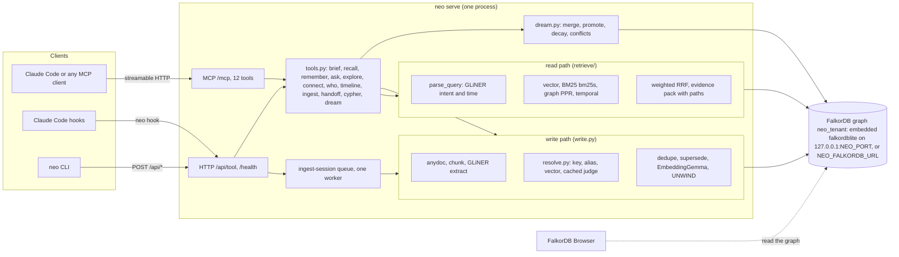

# Architecture

One local process owns the graph and the models. Agents reach it over MCP (streamable HTTP on `127.0.0.1:8765/mcp`) or through the `neo` CLI and the Claude Code hooks, which call the same daemon's `/api` routes. No LLM runs inside the system: GLiNER2.5 extracts, types, routes and judges; EmbeddingGemma embeds; the calling agent writes the answer from the evidence the tools return.

## Write path

1. Ingest input: `ingest_path` (a file or a directory tree) or `remember` (one text from an agent). A session transcript arrives as `ingest_session`, from the SessionEnd and PreCompact hooks, queued on the daemon's single worker thread.
2. Convert: Markdown and text are read directly; other formats go through `anydoc.to_markdown`. Images are skipped.
3. Chunk: 120 to 250 words on paragraph boundaries (chat threads on message boundaries). An unchanged document hash is skipped; a changed one is replaced with its chunks and REL edges.
4. Extract with GLiNER2.5: entities with per-type confidence floors, typed relations per sentence window, and deterministic patterns for ownership, dependencies and supersession phrases.
5. Resolve entities: exact key, alias, lone person name, then vector neighbours that pass a lexical guard. Borderline pairs go to a cached GLiNER judge, which can veto a merge but never create one.
6. Memories (`remember`): dedupe at cosine 0.92 (reinforce `uses`), flag conflicts at 0.75 to 0.92 with a shared entity, and link `SUPERSEDES` when the caller names the memory it replaces. Single-valued relations (OWNS per target, MEMBER_OF per person) end their old edge when a later document names a different counterpart.
7. Embed with EmbeddingGemma (`title: ... | text: ...` for documents, the search prompt for queries), float32, L2-normalized, 768 dimensions.
8. Write in batches: `UNWIND` statements for chunks, MENTIONS and REL, then refresh entity counts and first and last seen dates.

## Read path

1. `parse_query` (GLiNER): entities, intent (fact, connection, owner, temporal, howto) with confidences, and explicit time windows. Words like "current" and "latest" switch on recency only; they never filter.
2. Link query entities to graph nodes (exact key, fuzzy name, shared rare word, nearest embedding).
3. Run the channels, each returning a ranked list: vector (Chunk and Memory indexes), BM25 (bm25s over the same texts), graph (Personalized PageRank over a local subgraph seeded by the linked entities and the entities of the top dense and BM25 hits), temporal (window and recency).
4. Fuse with weighted reciprocal rank fusion: `score = sum_c w_c / (60 + rank_c)`. The weights start at 1.0 (temporal 0.5) and are scaled by the intent confidences (for example the graph channel is boosted for connection and owner questions).
5. Hide what should not surface: `merged` always, `superseded` unless the question is about change. Hydrate the top results with their document, source and date.
6. Return a token-budgeted, cited evidence pack: items with channel ranks, why each matched, and shortest graph paths between seeds (`algo.SPpaths`) for `ask` and `connect`.

## Dream

`neo dream` (or the `dream` tool) runs without an LLM: merge near-duplicate memories, promote an episodic cluster seen in 3 or more sessions to one semantic memory, decay unused memories (never deleted), and flag conflicting facts for the agent to resolve through `remember(..., supersedes=...)`. Each real run writes one `DreamRun` node, and a rerun changes nothing.

## Storage

- One graph per tenant (`neo_<tenant>`). The schema (vector, full-text and range indexes) is created on first use of a tenant.
- Embedded mode: `Store` starts falkordblite bound to `127.0.0.1:NEO_PORT` (default 6390) with its data at `NEO_HOME/neo.rdb`. The daemon is the only process that opens it; CLI commands fall back to a local store only when no daemon answers.
- Docker mode: set `NEO_FALKORDB_URL` to a running server (see `docker-compose.yml`). The code path is the same.

## Related

- Graph data model and MCP tool table: `README.md`.
- Every Cypher statement and the function that issues it: `docs/cypher.md`.
- Design rules and the plan: `knowledge/architecture/unified-plan.md`.
